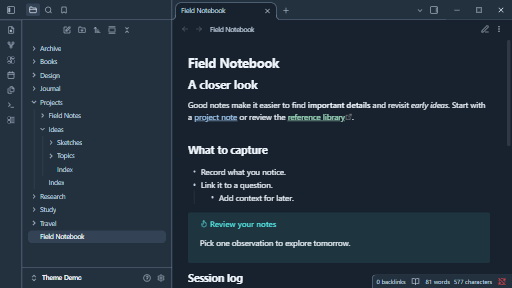
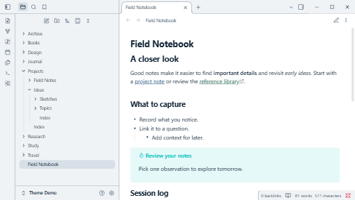

# Report Print

A professional Obsidian document theme with a planned print and PDF stylesheet.

Source version 1.0.1. Modes supported: Dark and light. Tested in Obsidian 1.15.1 on Windows.

The stylesheet includes print rules for tables, callouts and code. Page breaks can vary with the export engine.

## Preview

## Install manually

1. Download `manifest.json` and `theme.css` from [release 1.0.0](https://github.com/tutivsoft-com/obsidian-theme-report-print/releases/tag/1.0.0).
2. Put both files in `.obsidian/themes/Report Print/` in your vault.
3. Open **Settings > Appearance** and select **Report Print**. Choose a supported base colour scheme.

See the [original design plan](PLAN.md). [MIT license](LICENSE).
